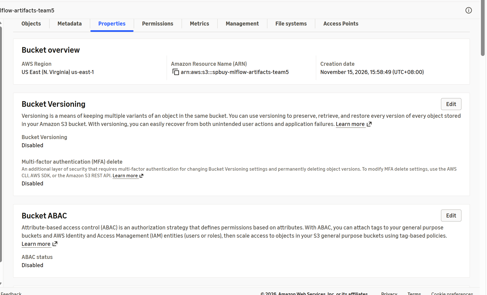
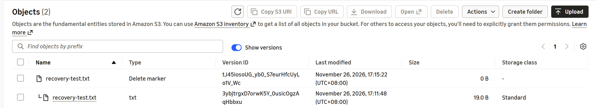
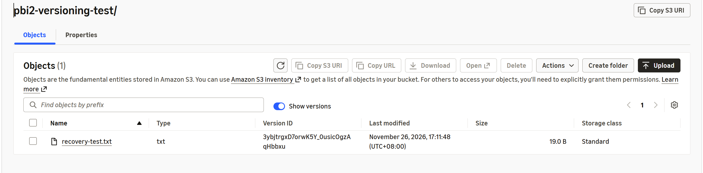
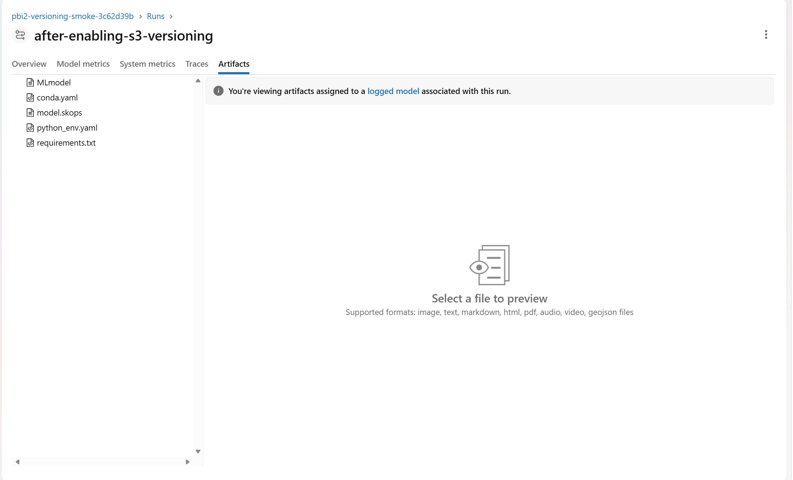
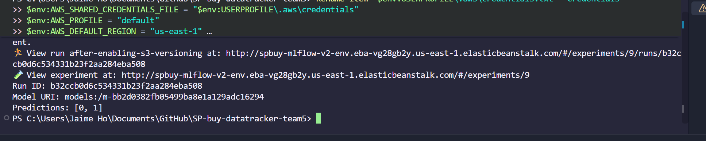

# PBI 8 — More Robust MLflow System Architecture

## Original setup

In PBI 2, I hosted MLflow on AWS Elastic Beanstalk in `us-east-1`. Amazon RDS for MySQL stored experiment metadata, and Amazon S3 stored model artifacts.

The tutorial used SQLite and stored artifacts inside the MLflow container. Data stored inside the container could be lost if the container was replaced. SQLite can also have write contention when multiple jobs log results at the same time.

## AWS options considered

I considered RDS for PostgreSQL and Aurora Serverless v2 for metadata storage. I kept RDS for MySQL because it was already configured, and switching databases would require a migration to preserve existing runs. I kept S3 because it stores model artifacts independently of the MLflow container.

## Improvement and S3 recovery test

I enabled **S3 Bucket Versioning** on the MLflow artifact bucket so previous versions could be recovered after an accidental deletion or overwrite.

I uploaded and deleted a disposable file named `recovery-test.txt`. S3 showed a delete marker alongside the original file version. After I removed the delete marker, the original file version reappeared.

## MLflow verification

After enabling versioning, I ran `test_mlflow.py` against the deployed MLflow server. The run finished successfully and showed the parameter `model_type = logistic_regression` and the metric `smoke_test_accuracy = 1.0`.

The script also loaded the saved model and returned the expected predictions, `[0, 1]`. This verified that experiment tracking and model logging and retrieval still worked after the change.

- **Run ID** `b32ccb0d6c534331b23f2aa284eba508`
- **Model URI** `models:/m-bb2d0382fb05499ba8e1a129adc16294`

