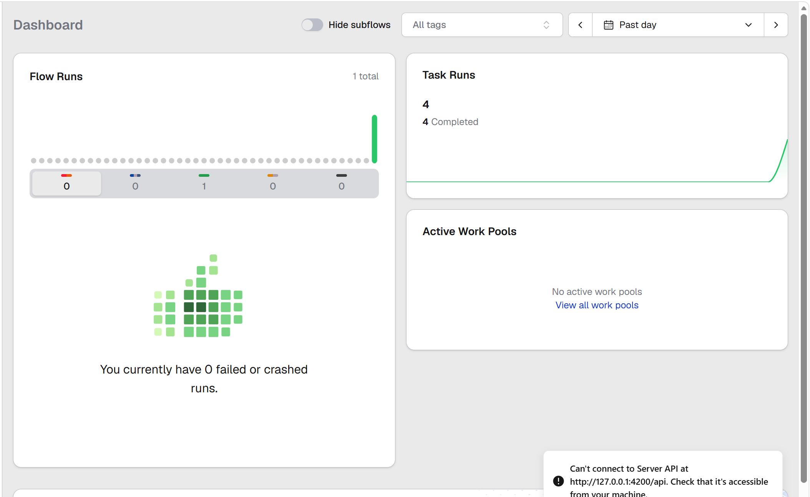
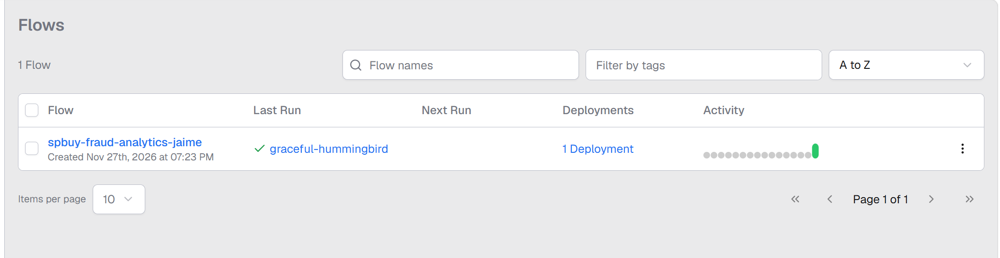
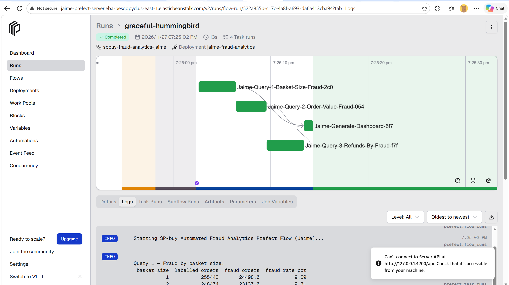
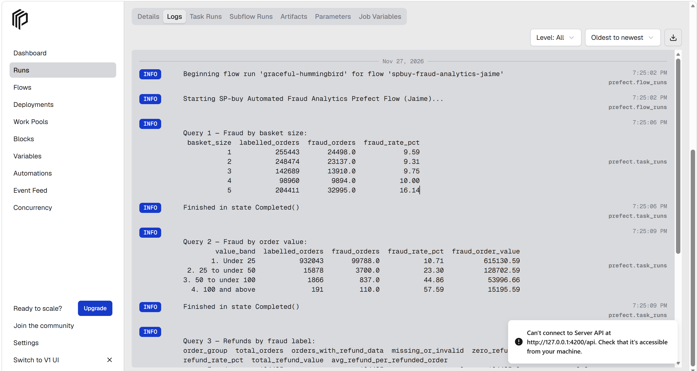
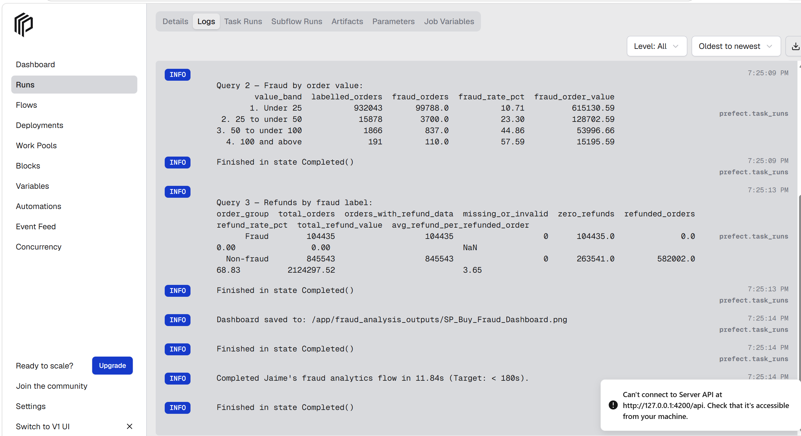

# AWS Prefect Challenge — Jaime

## URL to my Prefect service

[Prefect on AWS Elastic Beanstalk](http://jaime-prefect-server.eba-pesqdpyd.us-east-1.elasticbeanstalk.com/)

I deployed the Prefect server on Elastic Beanstalk and configured `jaime-prefect-db` on Amazon RDS PostgreSQL as its backend. A separate Docker container on the `jaime-prefect-runner` EC2 instance ran my fraud analytics flow against the team's RDS MySQL database.

## Location of files used to set up the service on AWS

The files are in the `SP-buy-datatracker-team5` repository on the `feat/jaime-prefect-aws` branch. The paths below are relative to the repository root.

| File | Purpose |
|---|---|
| `jaime-prefect-server/Dockerfile` | Builds and starts the Prefect web server on Elastic Beanstalk. |
| `jaime-prefect-server/Dockerfile.jaime-prefect-flow` | Builds the Docker image for the EC2 flow runner. |
| `jaime-prefect-server/requirements.txt` | Lists the runner's Python dependencies. |
| `database/jaime_queries.py` | Defines the fraud analytics tasks and serves the `jaime-fraud-analytics` deployment. |
| `database/db_config.py` | Reads the MySQL connection settings from environment variables. |

## Screenshots of the Prefect service and tasks running

The `graceful-hummingbird` run completed in about 13 seconds. All four tasks completed: Basket Size Fraud, Order Value Fraud, Refunds by Fraud, and Generate Dashboard.

### Prefect dashboard

### Registered fraud analytics flow

### Completed flow run

### Fraud query logs

### EC2 runner output

Some dashboard screenshots show a localhost API warning. The completed run page and EC2 terminal output show the successful execution.